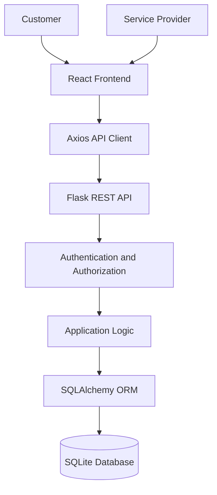
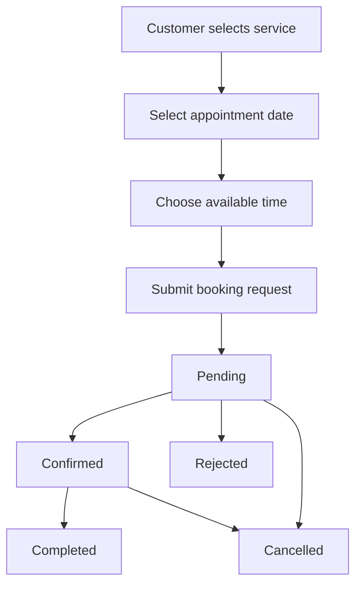

# BookEase

A full-stack service booking and appointment management platform that connects customers with service providers through a centralized digital workspace.

BookEase simplifies appointment scheduling, service discovery, business management, and booking administration while providing dedicated experiences for customers and service providers.

## Project Overview

Many service-based businesses rely on phone calls, messaging applications, and manual appointment records to manage bookings. These processes can lead to scheduling conflicts, inefficient communication, and poor customer experiences.

BookEase addresses these challenges by providing a digital platform where customers can discover services, view available appointment slots, and manage bookings, while service providers can organize their services, customers, schedules, and business operations.

## Key Features

### Authentication and Authorization

- Unified authentication interface.
- Customer and service provider registration.
- Secure password hashing using Bcrypt.
- JWT-based authentication.
- Role-based access control.
- Protected frontend routes and backend API endpoints.
- Role-specific dashboard navigation.

### Customer Workspace

- Dedicated customer dashboard.
- Browse available services and service providers.
- View service descriptions, prices, and durations.
- Select appointment dates and available time slots.
- Submit booking requests with optional notes.
- Track appointment statuses.
- Cancel eligible appointments.
- View booking history.

### Service Provider Workspace

- Dedicated business dashboard.
- Monitor booking statistics and earnings.
- Create, update, activate, and deactivate services.
- View and manage customer booking requests.
- Confirm, reject, and complete appointments.
- Access customer profiles and booking histories.
- Configure weekly business hours.
- View booking activity timelines.

### Appointment Scheduling

- Dynamic appointment availability.
- Service duration-based scheduling.
- Business hours validation.
- Existing booking overlap checks.
- Automatic exclusion of past appointment slots.
- Availability updates following booking cancellations.
- Support for provider-specific working schedules.
- East Africa Time (Africa/Nairobi) scheduling.

### Booking Lifecycle

Appointments can transition through the following statuses:

- Pending
- Confirmed
- Completed
- Cancelled
- Rejected

Booking activities are recorded to provide a chronological history of appointment actions.

## Technology Stack

### Frontend

| Technology | Purpose |
| --- | --- |
| React | User interface development |
| Vite | Frontend development and build tooling |
| JavaScript | Application logic |
| Tailwind CSS | Styling and layout |
| React Router | Client-side routing |
| Axios | HTTP requests and API integration |
| Lucide React | Interface icons |
| Recharts | Data visualization library |

### Backend

| Technology | Purpose |
| --- | --- |
| Python | Backend programming language |
| Flask | REST API development |
| SQLAlchemy | Object-relational mapping |
| SQLite | Local database |
| Flask-Migrate | Database migration management |
| Alembic | Database schema versioning |
| Flask-JWT-Extended | JWT authentication |
| Flask-Bcrypt | Password hashing |
| Flask-CORS | Cross-origin resource sharing |
| Python-dotenv | Environment variable management |

### Development Tools

- Visual Studio Code
- Git and GitHub
- Postman
- Windows Subsystem for Linux (WSL)
- Ubuntu

## System Architecture

BookEase follows a client-server architecture with a separate frontend and backend.



The React frontend handles user interactions and communicates with the Flask backend through REST API endpoints.

The backend handles authentication, authorization, business logic, appointment validation, and database operations.

## Database Design

The application uses a relational database with the following primary entities:

| Entity | Description |
| --- | --- |
| Users | Customer and provider accounts |
| Providers | Business profiles and provider information |
| Services | Services offered by providers |
| Bookings | Customer appointment records |
| Booking Activities | Chronological booking activity records |
| Provider Business Hours | Weekly provider working schedules |
| Reviews | Database model for future review functionality |

Database schema changes are managed using Alembic migrations.

## Appointment Workflow



The backend validates booking requests before storing them, including service availability, appointment duration, business hours where configured, and existing appointment conflicts.

## REST API

### Authentication

| Method | Endpoint | Description |
| --- | --- | --- |
| POST | /api/auth/register | Register an account |
| POST | /api/auth/login | Authenticate a user |
| GET | /api/auth/me | Retrieve authenticated user |

### Public Services

| Method | Endpoint | Description |
| --- | --- | --- |
| GET | /api/services/ | Retrieve available services |
| GET | /api/services/:id/availability | Retrieve available appointment slots |

### Customer Endpoints

| Method | Endpoint | Description |
| --- | --- | --- |
| GET | /api/customer/profile | Retrieve customer profile |
| PUT | /api/customer/profile | Update customer profile |
| GET | /api/customer/bookings | Retrieve customer bookings |
| POST | /api/customer/bookings | Create an appointment |
| PATCH | /api/customer/bookings/:id/cancel | Cancel an appointment |

### Provider Endpoints

| Method | Endpoint | Description |
| --- | --- | --- |
| GET | /api/provider/dashboard | Retrieve dashboard statistics |
| GET | /api/provider/profile | Retrieve business profile |
| PUT | /api/provider/profile | Update business profile |
| GET | /api/provider/services | Retrieve provider services |
| POST | /api/provider/services | Create a service |
| PUT | /api/provider/services/:id | Update a service |
| DELETE | /api/provider/services/:id | Deactivate a service |
| GET | /api/provider/bookings | Retrieve bookings |
| GET | /api/provider/bookings/:id | Retrieve booking details |
| PATCH | /api/provider/bookings/:id/confirm | Confirm a booking |
| PATCH | /api/provider/bookings/:id/reject | Reject a booking |
| PATCH | /api/provider/bookings/:id/complete | Complete a booking |
| GET | /api/provider/bookings/:id/activities | Retrieve booking activity |
| GET | /api/provider/customers | Retrieve customers |
| GET | /api/provider/customers/:id | Retrieve customer details |
| GET | /api/provider/business-hours | Retrieve business hours |
| PUT | /api/provider/business-hours | Update business hours |

Protected endpoints require a valid JWT access token and the appropriate user role.

## Project Structure

```text
bookease/
├── backend/
│   ├── app/
│   │   ├── middleware/
│   │   ├── models/
│   │   ├── routes/
│   │   ├── __init__.py
│   │   └── extensions.py
│   ├── migrations/
│   ├── .env.example
│   ├── config.py
│   ├── requirements.txt
│   ├── run.py
│   └── seed_services.py
├── frontend/
│   ├── public/
│   ├── src/
│   │   ├── assets/
│   │   ├── components/
│   │   ├── pages/
│   │   │   ├── auth/
│   │   │   ├── customer/
│   │   │   └── provider/
│   │   ├── services/
│   │   ├── App.jsx
│   │   └── main.jsx
│   ├── package.json
│   ├── package-lock.json
│   └── vite.config.js
├── .gitignore
└── README.md
```

## Getting Started

### Prerequisites

Ensure the following tools are installed:

- Python
- Node.js compatible with the project's Vite version
- npm
- Git

### 1. Clone the Repository

```bash
git clone https://github.com/arnoldwainaina2865/bookease.git
cd bookease
```

Repository access is required while the repository is private.

### 2. Backend Setup

Navigate to the backend directory.

```bash
cd backend
```

Create and activate a Python virtual environment.

```bash
python3 -m venv venv
source venv/bin/activate
```

Install the backend dependencies.

```bash
pip install -r requirements.txt
```

### 3. Environment Configuration

Create a local environment configuration file.

```bash
cp .env.example .env
```

Generate a secure random secret.

```bash
python -c "import secrets; print(secrets.token_hex(32))"
```

Run the command twice to generate independent values for the Flask secret key and JWT secret key.

Update the `.env` file with the generated values.

```env
SECRET_KEY=your_generated_flask_secret
JWT_SECRET_KEY=your_generated_jwt_secret
DATABASE_URL=sqlite:///bookease.db
```

Replace the placeholder values with your generated secrets.

Never commit the `.env` file or expose secret keys.

### 4. Initialize the Database

Apply the existing database migrations.

```bash
flask --app run.py db upgrade
```

Optionally populate the database with a sample provider and services.

```bash
python seed_services.py
```

The seed script securely prompts for a password when creating a new sample provider account.

### 5. Start the Backend

```bash
python run.py
```

The local backend API runs at:

```text
http://127.0.0.1:5000/api
```

### 6. Frontend Setup

Open a separate terminal and navigate to the frontend directory.

```bash
cd bookease/frontend
```

Install dependencies.

```bash
npm ci
```

Start the development server.

```bash
npm run dev
```

Open the local URL displayed by Vite, typically:

```text
http://localhost:5173
```

### 7. Build the Frontend

To generate a frontend production build:

```bash
npm run build
```

## Security Practices

The application currently implements:

- Bcrypt password hashing.
- JWT-based authentication.
- Role-based access control.
- Provider-specific resource access.
- Customer-specific booking access.
- Environment-based secret configuration.
- Backend request validation.
- Booking conflict detection.
- Git exclusion rules for private configuration and local databases.

Additional security hardening and automated security testing are planned before production deployment.

## Application Screenshots

Application screenshots will be added after the final user interface refinement.

Planned screenshots include:

- Unified authentication page.
- Service provider dashboard.
- Service management workspace.
- Customer management workspace.
- Provider business hours settings.
- Customer dashboard.
- Dynamic appointment booking interface.
- Customer booking history.

## Testing

Core application workflows have been tested manually using the local application, API requests, and Flask's test client.

An automated test suite is planned to improve regression testing, reliability, and coverage.

## Future Improvements

- Automated backend and frontend testing.
- Concurrency-safe appointment booking.
- PostgreSQL integration for production.
- Environment-based frontend API configuration.
- Responsive and accessibility improvements.
- Email and SMS appointment notifications.
- Customer reviews and ratings.
- Online payment integration.
- Administrative dashboard.
- Continuous integration and deployment.
- Production monitoring and logging.

## Project Status

BookEase is currently under active development.

The core customer and service provider workflows have been implemented. Production deployment, comprehensive automated testing, and additional security hardening remain in progress or are planned.

## Author

**Arnold Mwangi Wainaina**

Software Developer | Full-Stack Development

- [GitHub](https://github.com/arnoldwainaina2865)
- [LinkedIn](https://www.linkedin.com/in/arnoldwainaina/)
- [Portfolio](https://arnoldwainaina2865.github.io/Personal-Portfolio/)
